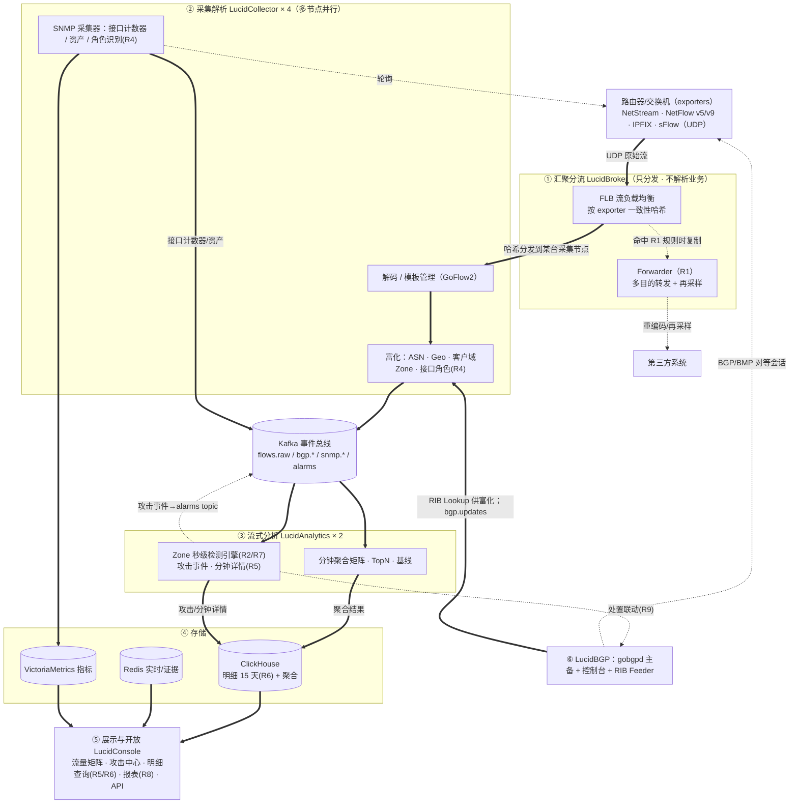
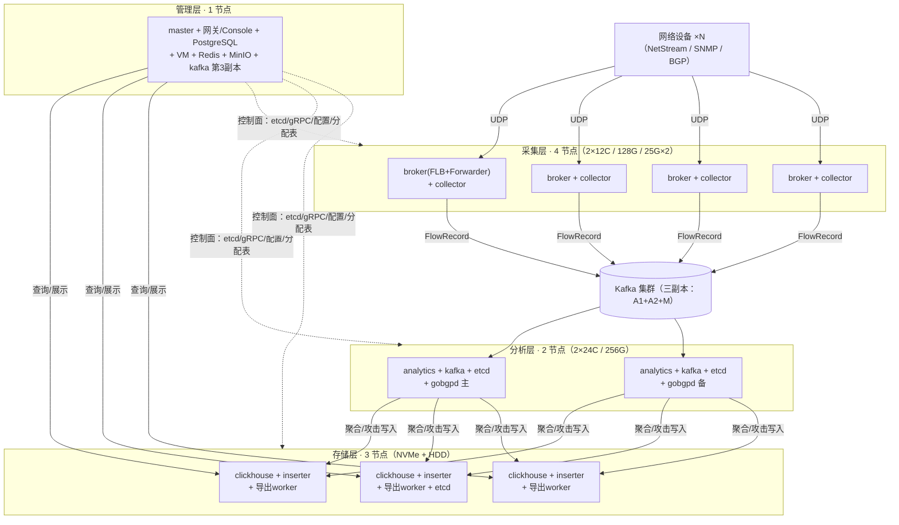

# LucidNet 网络流量智能分析平台 — 总体架构规划

> 版本：v0.4｜日期：2026-10-24
> v0.1 → v0.2：吸收 9 项细化需求（R1–R9，见需求追踪矩阵）；新增 LucidBGP 模块；存储保留期调整为**明细 15 天**并重算容量；文档体系拆分为各模块概要设计 + 详细设计。
> v0.2 → v0.2.1：§3 架构图重绘（Mermaid），新增"一条流记录的旅程"数据流说明、物理部署视图、分流层论证与部署形态。
> v0.2.1 → v0.3：新增 **08 LucidDeploy（部署与升级）**模块：制品/版本规范、lucidctl 一键安装、滚动升级/灰度/回滚、Console 部署中心；许可确立为 AGPL-3.0-only + 商业双许可。
> v0.3 → v0.3.1：跨模块接口核对，修正 6 处不一致（明细落库通道/zone_side/互联过滤语义/Broker 配置通道/RIB 服务命名/baseline DDL），新增 **09 模块间接口契约**（并行开发唯一权威）。
> v0.3.1 → v0.4：新增 **10 UI 设计规范**（图标库/设计 token/菜单与术语/大屏）与 **11 代码与工程命名规范**（Go/Java/TS/DB/指标/Git/CI 检查），为并行开发提供工程约定。
> 定位：基于 NetStream/NetFlow/IPFIX/sFlow、SNMP、BGP/BMP 多源数据，提供**网络流洞察、流量波动分析、秒级攻击检测与处置闭环**的一体化产品。
> 对标：Genie Networks GenieATM/FLB；参考 Akvorado（开源架构）、Gigamon（报文侧分流）。
> 性能目标：**10 台服务器集群 ≥100 万 flows/s 持续处理，IPv4/IPv6 双栈**。

---

## 1. 需求追踪矩阵（R1–R9）

| # | 需求（用户提出） | 承载模块 | 设计文档 |
|---|---|---|---|
| R1 | 原始数据流按源 IP（或分组）设置多目的转发，转发支持再采样 | Broker · Forwarder 子模块 | docs/dd/01 |
| R2 | 秒级 DDoS 检测；客户级监测对象，300 客户 × 1000 IP | Analytics · Zone 检测引擎 | docs/dd/03 |
| R3 | IPv4 + IPv6 双栈 | 全模块（公共数据模型统一承载） | docs/00 + 各模块 |
| R4 | 依据 SNMP 信息推算网络边界接口，分析时去除互联接口 | Collector · 接口角色识别 | docs/dd/02 |
| R5 | 分钟级攻击详情；攻击时段原始日志查阅与导出（格式化文本） | Analytics + Storage + Console | docs/dd/03/04/05 |
| R6 | 原始日志保留 15 天，Web 页面按条件查询 | Storage + Console | docs/dd/04/05 |
| R7 | 扫段攻击分析；客户总流量异常波动告警 | Analytics | docs/dd/03 |
| R8 | 报表功能，可自定义流量分析报表 | Console · 报表中心 | docs/dd/05 |
| R9 | BGP 路由管理（基于 rsbgp-console 改名 **LucidBGP**） | LucidBGP | docs/hld/06 + docs/dd/06 |

原始 v0.1 需求（流洞察/波动分析/攻击检测、100w fps、集群化）继续有效，编号从 R10 起顺延（见各模块文档）。

## 2. 产品核心能力

| 能力 | 说明 |
|---|---|
| 网络流洞察 | 谁（IP/AS/地理/客户域）在什么链路（设备/接口/方向）上跑什么业务，分钟级流量矩阵、TopN、15 天明细钻取 |
| 流量波动分析 | 分钟粒度动态基线、突变检测、同环比、客户域总流量波动告警（R7）、容量趋势 |
| 攻击检测与处置 | **秒级**（R2）客户域 DDoS 检测（泛洪/反射/扫段 R7）、分钟级攻击详情与原始日志取证（R5）、经 LucidBGP 一键 Flowspec/黑洞处置（R9） |
| 数据分发 | 原始流按 exporter/分组多目的转发 + 再采样（R1），供第三方系统消费 |

## 3. 总体架构

### 3.1 逻辑数据流（数据面主链路）

**一条流记录的旅程（主链路，实线）**：

1. 路由器/交换机把 NetStream/sFlow 通过 UDP 发给**汇聚分流层**（设备侧只配 FLB 地址，不配 N 台采集机）。
2. **① 汇聚分流**不解析流内容，只做两件事：按 exporter 一致性哈希把 UDP 报文分发给某一台**② 采集节点**；命中 R1 转发规则时复制一份重编码发给第三方系统。
3. **② 采集解析**（4 节点并行，各管一部分设备）解码模板与记录 → 归一化 FlowRecord → 富化（AS/Geo/客户域/接口角色）→ 写 Kafka。
4. **Kafka** 总线解耦上下游。
5. **③ 流式分析**消费 Kafka：分钟聚合、TopN、基线、Zone 秒级检测；聚合结果与攻击事件分别落存储。
6. **④ 存储**：ClickHouse（明细 15 天 + 聚合表）、Redis（实时状态/证据）、VictoriaMetrics（指标）。
7. **⑤ 展示与开放只读存储与缓存、调各模块 API——不在数据通路上**，它宕机不影响采集与分析。

**旁路通道（虚线）**：SNMP 是②里的 snmp-agent **主动发起轮询**的独立通道，不经分流层；BGP/BMP 由⑥ LucidGP 的 gobgpd 维护对等会话、RIB Feeder 为②提供 IP→ASN 富化；攻击处置是控制流闭环：③ → alarms → ⑥下发 → 回执 → ③验证缓解。

### 3.2 物理部署视图（10 节点，模块到机器的映射）

### 3.3 为什么"汇聚分流"要独立成层（而不是设备直发采集节点）

| 原因 | 说明 |
|---|---|
| **模板粘性** | NetFlow v9/IPFIX 的模板与数据报文必须落在同一节点解码；普通轮询式 UDP 负载均衡会把同一 exporter 的报文打散到多台机器导致大面积丢流。FLB 按 exporter **一致性哈希**保证同设备同节点 |
| **扩缩容不动设备** | 设备侧只配 FLB 地址（或 VIP）；采集节点扩容/排水/升级只改 Master 下发的分配表，不用改 N 台路由器配置 |
| **按权重调度** | Master 观测每 exporter 实测速率与节点容量权重做分配，超重载 exporter（>5w fps）独占绑定 |
| **R1 天然同源** | 多目的转发/再采样与分流共用同一份收包路径，一次收包两用，零额外开销 |

已评估的替代方案：LVS/Nginx UDP 源 IP 哈希（可行，但排水/权重/R1 仍要自研，还多一套运维面）；设备 NetStream 双目的直发两台采集机（配置量随节点数 ×N 增长、无法弹性扩容）；组播（网络侧不可控）——均被否。

### 3.4 部署形态

| 形态 | 适用 | 差异 |
|---|---|---|
| **标准分层**（默认，本图） | ≥5 节点 / >30w fps | FLB 与 Collector 分进程部署于采集节点 |
| **一体化** | ≤3 节点 / ≤30w fps（POC/小网点） | FLB 内嵌进 collector 同进程（同二进制开关），设备直连每台采集，Master 分配表仅用于 R1 转发与故障切换 |

## 4. 模块与文档索引

| # | 模块 | 职责一句话 | 概要设计 | 详细设计 |
|---|---|---|---|---|
| 00 | 公共规范 | 数据模型（proto/DDL/Topic/API） | — | docs/00-公共数据模型与接口规范.md |
| 01 | LucidBroker | FLB 分流 + R1 多目的转发/再采样 +（可选）DPDK | docs/hld/01 | docs/dd/01 |
| 02 | LucidCollector | 流解码归一化富化 + SNMP/接口角色识别(R4) | docs/hld/02 | docs/dd/02 |
| 03 | LucidAnalytics | 聚合/基线/秒级 Zone 检测(R2)/扫段(R7)/攻击详情(R5) | docs/hld/03 | docs/dd/03 |
| 04 | LucidStorage | ClickHouse 明细 15 天(R6)/聚合/时序/导出归档 | docs/hld/04 | docs/dd/04 |
| 05 | LucidConsole | Web 控制台/攻击中心/报表中心(R8)/API | docs/hld/05 | docs/dd/05 |
| 06 | LucidBGP | BGP 路由管理与处置（rsbgp-console 改名） | docs/hld/06 | docs/dd/06 |
| 07 | LucidMaster | 集群管理/配置/RBAC/自监控 | docs/hld/07 | docs/dd/07 |
| 08 | LucidDeploy | 制品规范/一键安装/滚动升级/回滚/部署中心页面 | docs/hld/08 | docs/dd/08 |
| 09 | 接口契约 | 模块间数据接口唯一权威（Kafka/gRPC/etcd/PG/CH/端口/裁定记录） | — | docs/09-模块间接口契约.md |
| 10 | UI 设计规范 | 图标库/设计 token/菜单与术语/大屏（Console 前端权威） | — | docs/10-UI设计规范.md |
| 11 | 命名规范 | Go/Java/TS/DB/指标/Git/权限码/CI 检查（全模块权威） | — | docs/11-代码与工程命名规范.md |

## 5. 关键设计决策（摘要，细节见各模块文档）

1. **Zone（客户域）模型（R2）**：客户 = IP 集合（v4/v6 混合，单客户上限 1000 条），在采集侧富化 `zone_id`，Kafka 按其分区 → 分析侧无锁并行秒级检测；300 客户 × 1000 IP 全量内存 < 10MB，检测内存预算 < 4GB。
2. **接口角色识别（R4）**：SNMP ifTable/ifAlias + LLDP-MIB/OSPF-MIB 邻居 + 命名正则 + 人工覆盖 → 接口标记 `boundary|internal`；分析默认剔除 internal（互联）接口，防重复计量与互联噪声。
3. **存储分层（R6）**：明细 15 天（NVMe 热 3 天 + HDD/对象冷 12 天，ClickHouse TTL TO VOLUME 自动迁移），分钟聚合 13 个月，小时聚合 3 年。
4. **处置闭环（R2+R9）**：Analytics 攻击事件 → Kafka `alarms` → LucidBGP 告警联动页一键下发（黑洞/限时撤销，路线图加 Flowspec）→ 处置回执回写 → Analytics 关联攻击事件验证缓解效果。
5. **转发器（R1）**：透传复制（零改动、不支持再采样）与代理重编码（解码→按目的地再采样→重编 NetFlow v5/IPFIX）双模式。
6. **全链路 IPv4/IPv6（R3）**：统一 128bit 地址表示（v4 映射 ::ffff:0:0/96），LPM/RIB、Zone 匹配、存储与 UI 全部双栈。

## 6. 性能与容量（100 万 flows/s 基准）

**吞吐账**
- 采集：单节点规划 30w fps（压测 50w），4 采集节点 N+1 冗余 120w。
- 分析：Kafka 按 zone/exporter 分区并行，Go 算子单核聚合 ≈ 50–100w records/s，2×24 核分析节点充裕。

**存储账（明细 15 天，R6）**
- 100w fps → 864 亿行/天 × 压缩 15–25 B/行 ≈ **1.3–2.2 TB/天**；
- 15 天 ≈ **20–33 TB**（单副本），CH 双副本 40–66 TB raw；
- 结论：明细必须冷热分层（NVMe 承接近 3 天 + HDD/对象冷卷 12 天），并提供"超阈值降采样"开关（如均值 >50w fps 时非重点 zone 1:N 抽样，记录保留 `sample_rate`，查询侧加权还原）。
- 容量公式：`磁盘 ≈ fps × 86,400 × 20B × 天数 × 副本数 / 降采样系数`，按现场均值流量重算。

**10 台布局（v0.2 修订）**

| 节点数 | 配置 | 角色 |
|---|---|---|
| ×4 | 2×12C, 128G, 2×25G | Broker(FLB/Forwarder) + Collector（各 30w fps，N+1） |
| ×2 | 2×24C, 256G, NVMe×2 | Analytics + Kafka broker（其中 1 副本借第 10 台） |
| ×3 | 16C, 128G, 2×NVMe(7.68T) + 8×HDD(20T) | ClickHouse（3 分片，明细双副本，冷热分层） |
| ×1 | 通用 16C | Master + Console + PostgreSQL + VM + Redis(主) + Kafka 第 3 副本 |

> 高配建议 12 台（Kafka 独立 3 台 + Master 双机）；10 台为紧约束方案，已在 docs/dd/07 论证风险。

## 7. 里程碑（v0.2 修订）

| 阶段 | 内容 | 关键验收 |
|---|---|---|
| M0 PoC（4–6 周） | goflow2→Kafka→ClickHouse→Grafana 打通；Zone 富化原型；LucidBGP 从 rsbgp-console 完成改名与 token 对接 | 单机 50w fps 压测报告 |
| M1 MVP（~3 月） | FLB + Forwarder(R1) + 采集集群 + IPv6(R3) + 接口角色(R4) + 分钟聚合 + 核心看板 + SNMP + **部署框架(08: agent/lucidctl/install)** | 3 节点 30w fps；R1/R3/R4 验收；**3 节点一键安装演练** |
| M2 检测与取证（~3 月） | Zone 秒级检测(R2) + 扫段(R7) + 波动告警(R7) + 攻击分钟详情与原始日志导出(R5) + 15 天查询(R6) + 流量矩阵 UI + LucidBGP 告警联动处置 + **滚动升级/回滚(08)** | **10 节点 100w fps + 300 客户模拟压测 + 攻击演练 + 升级回滚演练** |
| M3 增值（~3 月） | 报表中心(R8) + Flowspec 处置 + 多租户 + 容量预测 + 可选 DPDK 报文分流 | R8/R9 全量验收 |

## 8. 主要风险与对策（v0.2 增补）

| 风险 | 对策 |
|---|---|
| 15 天明细容量失控（R6） | 冷热分层 + 可配置降采样 + 容量公式现场重算；明细表按天分区可快速 ALTER TTL |
| 秒级检测内存/抖动（R2） | Zone 命中前置到采集侧；环形窗口固定内存；per-src 聚合设上限+Count-Min 兜底 |
| NetStream ifIndex 与 SNMP ifIndex 不一致（R4） | 采集侧接口流量对账校验，不一致设备告警并人工映射 |
| 再采样重编码模板漂移（R1） | 代理模式输出统一 NetFlow v5 / 自有模板 IPFIX，不透传原模板 |
| gobgpd 工作副本限制（策略挂载/双条件语句） | 继承 rsbgp-console 已验证的规避方案（策略骨架一次性挂载、成员级增删），见 docs/dd/06 |

## 9. 参考

- GenieATM（对标）：https://www.genie-networks.com/genieatm
- GoFlow2：https://github.com/netsampler/goflow2｜gobgp：https://github.com/osrg/gobgp
- rsbgp-console（私有，R9 基础）：`SchearLoe/rsbgp-console`（gobgpd-v4.10.0 分支）
- Akvorado：https://github.com/akvorado/akvorado｜DPDK：https://www.dpdk.org/
